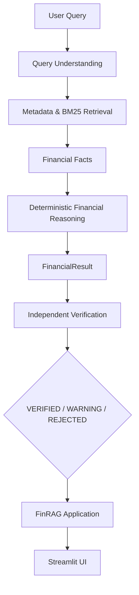

# FinRAG Vietnamese Financial AI

> A trustworthy, provenance-aware AI system for financial question answering, numerical reasoning, and financial research over Vietnamese corporate reports.

## 1. Overview
FinRAG is an early-stage research and engineering project aimed at solving the reliability problem of LLMs in financial domains. It focuses on Vietnamese corporate financial statements, extracting raw financial facts and applying deterministic numerical reasoning to answer natural-language queries with deterministic, traceable provenance.

## 2. Problem
Modern LLMs are notoriously unreliable for financial reasoning. They frequently hallucinate numbers, fabricate arithmetic operations, silently substitute missing data, and provide answers without source-level traceabilty. In a high-stakes environment like corporate finance and auditing, such flaws make standard RAG (Retrieval-Augmented Generation) systems unusable.

## 3. Why trustworthy financial QA is difficult
- **Table Complexity:** Financial statements contain deeply nested tables, hierarchical headers, and span multiple pages.
- **Accounting Semantics:** Figures depend heavily on strict semantics (e.g., fiscal year vs. report publication year, consolidated vs. separate statements, comparative figures).
- **Mathematical Sensitivity:** A single incorrect digit or a misinterpreted sign (e.g., negative parentheses) changes the financial reality of a company.
- **Lack of Traceability:** When an LLM outputs an ROI or Revenue figure, it is practically impossible to trace exactly which line item, from which table, on which page of a 100-page PDF generated that number.

## 4. System Architecture

The MVP FinRAG system completely decouples Natural Language intent parsing from Financial Computation to provide deterministic numerical computation.



**Key Architectural Constraints:**
- **Retrieval (Day 3):** Fetches the actual financial facts from the indexed parquet corpus.
- **Reasoning (Day 4):** Deterministic and formulaic. No LLM arithmetic generation.
- **Verification (Day 5):** An independent module that audits the result before it is presented to the user.
- **UI (Day 6):** The application layer is strictly a presentation and diagnostic layer; it contains no calculation logic.

**Data Provenance Chain:**
`Answer -> FinancialResult -> Input Facts -> Fact ID -> Row -> Table -> Page -> Source Document`

## 5. Data
The project currently uses a structured subset of the public **ViFinQA** dataset (which builds upon the TiniX Vietnamese financial report corpus).

- **Corpus Source:** ViFinQA
- **Total Processed Financial Facts:** 338,714
- **Storage:** Local `.parquet` file (`data/processed/financial_facts.parquet`)
- **Note on Coverage:** The current MVP does not encompass every Vietnamese company. The data acts as a robust testbed for the extraction, reasoning, and verification pipeline rather than a complete market terminal.

## 6. Retrieval
A deterministic metadata and BM25-based retrieval system queries the parquet-backed `FinancialFact` records. Filtering explicitly handles multi-dimensional constraints such as `ticker`, `fiscal_year`, `statement_scope` (e.g., consolidated vs. separate), and `line_code`.

## 7. Deterministic Reasoning
Uses an explicit `FinancialReasoningEngine` guided by a `MetricRegistry`. Support is limited to an MVP scope of 8 financial metrics (e.g., Net Revenue, Net Margin, ROA, ROE, YoY Growth). If a calculation requires inputs that are not present, the system cleanly rejects the query instead of guessing.

## 8. Independent Verification
The `VerificationEngine` independently re-calculates and validates the `FinancialResult`. It checks:
- Numerical accuracy (Oracle check).
- Formula integrity.
- Period semantics (ensuring comparative facts are safely aligned).
- Unit coherence (VND vs. Ratio).
- Provenance (one-to-one correspondence between calculation inputs and evidence).
- Methodology (e.g. warning when calculating ROA/ROE using a closing balance instead of a 2-year average).

## 9. UI
The user interface is a professional Streamlit application. Designed to eschew "AI-gimmicks," it focuses on high contrast (WCAG AAA/AA), tabular-monospace typography for figures, clear diagnostic guidance on query failure, and prominent verified/warning/rejected auditing badges.

## 10. Evaluation
The FinRAG MVP enforces rigorous correctness via a dense test suite and dedicated benchmarking against the 338,714-fact corpus.

| Component | Metric | Score | Evaluation Scope |
| :--- | :--- | :--- | :--- |
| **Reasoning Engine** | Valid Calculation Accuracy | **100.0%** (25/25) | 30-case MVP reasoning benchmark |
| | Invalid Query Rejection | **100.0%** (5/5) | 30-case MVP reasoning benchmark |
| **Verification Engine** | Valid Acceptance Rate | **100.0%** (30/30) | 60-case MVP verification benchmark |
| | Mutation Detection Rate | **100.0%** (30/30) | 60-case MVP verification benchmark (detecting injected corrupted states) |
| | False Acceptance Rate | **0.00%** | 60-case MVP verification benchmark |
| **Engineering** | Test Suite Pass Rate | **100.0%** (164/164)| Full `pytest` repository test suite |

> *Note: These metrics indicate 100% accuracy and robustness within the scope of the curated benchmarks for the supported MVP metrics, rather than universal coverage of all Vietnamese financial statements.*

## 11. Example Queries

Below are representative queries supported by the system, showcasing various layers of reasoning and semantics:

1. **`Doanh thu thuần FPT năm 2024`**
   - **Type:** Absolute metric (identity operation).
   - **Verification State:** `VERIFIED`
   - **Why representative:** Demonstrates baseline retrieval, exact VND value rendering, and source provenance for a fundamental accounting line code.

2. **`Biên lợi nhuận ròng FPT năm 2024`**
   - **Type:** Ratio calculation.
   - **Verification State:** `VERIFIED`
   - **Why representative:** Demonstrates multi-fact retrieval (Net Income / Net Revenue), computation to a percentage, and provenance mapping for both distinct input variables.

3. **`ROE VNM năm 2023`**
   - **Type:** Ratio calculation with comparative semantics.
   - **Verification State:** `WARNING`
   - **Why representative:** Showcases the system's ability to identify and safely utilize comparative disclosures. The UI explicitly alerts the user: `[Số liệu so sánh (BCTC 2024)]`, clarifying that while the query requests fiscal year 2023 data, the evidence is securely extracted from the audited 2024 report filing.

4. **`Tăng trưởng doanh thu FPT năm 2024`**
   - **Type:** Year-over-Year (YoY) growth.
   - **Verification State:** `VERIFIED`
   - **Why representative:** Multi-period reasoning. Evaluates the capacity to fetch current and prior year metrics simultaneously and calculate delta percentages accurately.

5. **`Doanh thu thuần XYZ năm 2024`**
   - **Type:** Invalid query (Missing ticker).
   - **Verification State:** `ERROR` (`DATA_NOT_FOUND`)
   - **Why representative:** Illustrates the decoupled application service. Rather than crashing, the system gracefully halts at the retrieval boundary and presents the user with actionable diagnostics, listing the actually supported tickers.

## 12. Installation

Dependencies and exact environment requirements are managed via `requirements.txt`.

```bash
# 1. Clone the repository
git clone https://github.com/Vennyx14/finrag-vietnamese-financial-ai.git
cd finrag-vietnamese-financial-ai

# 2. Create and activate a Python 3.11 virtual environment
python -m venv .venv
# Windows:
.venv\Scripts\activate
# Unix/MacOS:
source .venv/bin/activate

# 3. Install dependencies
pip install -r requirements.txt
```

## 13. Running the System

To launch the FinRAG Financial Research UI:

```bash
python -m streamlit run ui/app.py --server.port=8501
```
Navigate to `http://localhost:8501` in your browser.

## 14. Running Tests & Evaluation

To reproduce the benchmark figures and engineering robustness:

**Run the full test suite:**
```bash
python -m pytest -v
```

**Run reasoning benchmark:**
```bash
python scripts/evaluate_reasoning.py
```

**Run verification mutation benchmark:**
```bash
python scripts/evaluate_verification.py
```

## 15. Repository Structure
```text
finrag-vietnamese-financial-ai/
├── src/                 # Core financial logic and domain models
│   ├── ingestion/       # Extractor, parser, and schema validation
│   ├── retrieval/       # Metadata filtering, indexing, and BM25 (Day 3)
│   ├── financial/       # Deterministic calculations and Verification Oracle (Day 4/5)
│   └── application/     # FinRAGApplication service and typed DTOs (Day 6)
├── tests/               # 164 robust unit and integration tests
├── scripts/             # Profiling, evaluation, and benchmark runners
├── ui/                  # Streamlit frontend application and design tokens
├── data/
│   └── manifests/       # JSON tracking of dataset scopes and benchmark quality
├── docs/                # Architecture and Portfolio positioning files
├── PRODUCT.md           # Product philosophy and target constraints
├── DESIGN.md            # UX, contrast, and typography design tokens
└── AGENTS.md            # Internal AI agent rules
```

## 16. Limitations
FinRAG is an early MVP and operates under strict, deliberate constraints:
- **Limited Metric Support:** Currently calculates only 8 core metrics (`net_revenue`, `net_income`, `total_assets`, `equity`, `net_margin`, `roa`, `roe`, `revenue_growth`).
- **Deterministic Keyword Parsing:** Natural language understanding relies on deterministic matching rather than a highly generalizable LLM semantic parser.
- **BM25 Constraints:** Relies strictly on BM25 and exact metadata filters; cannot resolve conceptually distant synonyms.
- **Methodology Defaults:** Uses closing-balance methodology for ROA/ROE due to current snapshot limitations, generating an explicit methodology warning rather than computing a 2-year average.
- **Narrow Unit Conversion:** Understands basic Vietnamese denomination terminology (e.g. tỷ, triệu) but lacks a comprehensive multi-currency engine.
- **No Novel Ingestion:** Source consistency verification confirms page/table location but does not actively re-parse raw PDFs per query.
- **Format Biases:** Tuned against standard commercial reporting schemas; not equipped for non-standard banking/insurance schemas.

## 17. Future Work
The following capabilities are **not implemented** but represent the logical next steps on the product roadmap:
- Dense vector retrieval and hybrid RAG search.
- Integration of a true Financial Domain Specific Language (DSL).
- Reranking of multi-table contexts.
- Automated multimodal ingestion directly from raw SEC/UBCK PDFs.
- Financial Knowledge Graphs connecting subsidiaries and executive boards.
- Implementation of an autonomous Analyst Agent capable of comparative industry reporting.

## 18. Research Direction
Potential research extensions arising from this foundation include:
- **Accounting-Schema-Aware Retrieval:** Exploring how hierarchical accounting structures (e.g., VAS hierarchies) can improve retrieval precision over flat BM25 vectors.
- **Provenance-Aware Executable Reasoning:** Investigating frameworks where LLMs output abstract calculation intents that are securely executed and validated by deterministic computational oracles.
- **Independent Verification for Financial QA:** Evaluating methods to auto-generate adversarial mutations of financial data to harden RAG system reliability.

## 19. License
All rights reserved. Research use authorized under the current FinRAG milestone.